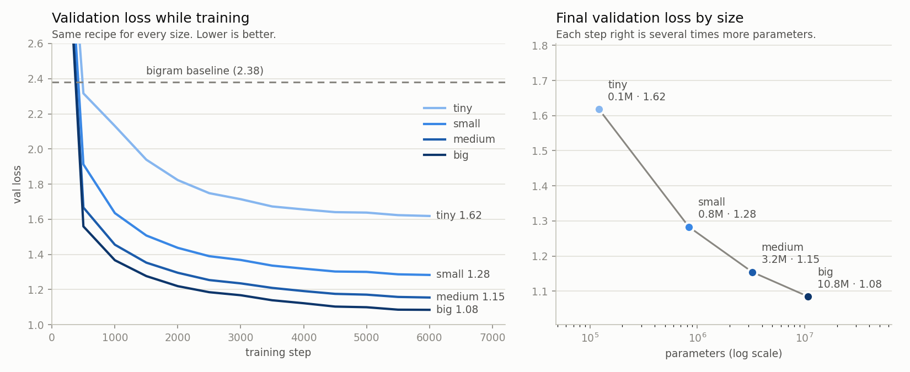

# llm-from-scratch

Building a small **GPT-style language model from scratch in PyTorch**, one piece
at a time, to actually understand how modern LLMs work under the hood — not to
beat them.

It reads a large pile of text, learns the character-level patterns in it, and
generates new text in the same style. A tiny **decoder-only transformer** built
without any pre-made model libraries (tokenizer → embeddings → attention →
training → generation).

The model is intentionally small and not "smart" — the point is learning the
machinery, not shipping a product.

**Stack:** Python · PyTorch · matplotlib (loss curves) · trained on Apple
Silicon (MPS) and on rented cloud GPUs (SkyPilot on Google Cloud).

---

## How it works

```
"the game is a"                                      text
   │ tokenizer.py: one id per character (102 in total)
   ▼
[71, 59, 56, 1, 58, 52, 64, 56, 1, 60, 70, 1, 52]    ids
   │ model.py: token embedding (which character)
   │         + position embedding (where it sits)
   ▼
384 numbers per position (up to 128 positions)
   │
   ▼ 6 transformer blocks, each one:
   │   layer norm → self-attention, 6 heads (looks back only) → add to input
   │   layer norm → feed-forward, 384 → 1536 → 384             → add to input
   ▼
final layer norm → linear layer → 102 scores, one per possible next character
   │ generate.py: ÷ temperature → keep the top k → softmax → weighted dice roll
   ▼
" " (a space) → add it to the text, and repeat
```

`train.py` teaches the model by showing it 128-character slices of text and
nudging its 10.8M numbers to make the real next character more likely. It saves
the best version to `checkpoints/gpt.pt`, which `generate.py` loads to write.
Every setting lives in [config.py](config.py).

---

## Progress

- [x] **Stage 1 — Data + tokenizer**
- [x] **Stage 2 — Bigram baseline** (a deliberately dumb model to beat)
- [x] **Stage 3 — The transformer** (self-attention, multi-head, blocks)
- [x] **Stage 4 — Train properly + loss curves**
- [x] **Stage 5 — Generation (temperature, top-k sampling)**
- [x] **Stage 6 — Refactor, one experiment, writeup** ← *you are here*
- [ ] Stage 7 — Live demo (FastAPI backend)

### Stage 1 — done

A complete character-level data pipeline:

- **Dataset** — ~2.6M characters of public-domain **Sherlock Holmes** text from
  Project Gutenberg. See [data/](data/).
- **Tokenizer** — character-level `encode` / `decode` over a 102-character
  vocabulary. See [tokenizer.py](tokenizer.py).
- **Batching** — train/val split plus random `(input, next-character target)`
  batches, placed on the Mac GPU. See [data.py](data.py).
- **Tests** — round-trip and batch shape/alignment checks. See
  [tests/test_stage1.py](tests/test_stage1.py).

### Stage 2 — done

A **bigram** baseline: the simplest possible model, which predicts the next
character from only the current one. It is a single 102 × 102 lookup table
(10,404 parameters). It is meant to be bad. Its job is to get the whole loop
working (data → model → loss → train → generate) and to set a score for the
transformer to beat. See [bigram.py](bigram.py).

| | Loss |
|---|---|
| Even guess among 102 characters | 4.62 |
| Untrained (random table) | 5.19 |
| Trained, 3,000 steps (~10 s on MPS) | **2.42 train / 2.38 val** |

Sample after training: letter patterns and short words look right, but there is
no meaning yet, because the model only ever sees one character:

```
 thenf ug ly. menok cat   her owie pler  thed beensund he tf  the amullimetheroore  mand mowan on.
```

- **Tests** — output shapes, untrained loss near a blind guess, training lowers
  the loss, generation length. See [tests/test_stage2.py](tests/test_stage2.py).

### Stage 3 — done

A small **decoder-only transformer** (GPT-style), built piece by piece in
[model.py](model.py):

1. Token + position embeddings: *which* character, and *where* it sits
2. One self-attention head, with a mask so no position can see the future
3. Multi-head attention: 4 heads side by side
4. Feed-forward layer, run at every position
5. Transformer block: attention + feed-forward, with residual connections and
   pre-layer-norm
6. 4 blocks stacked, then a final layer norm and a layer that scores the next
   character

834,406 parameters, 128-character context. The training loop in
[train.py](train.py) is shared with the bigram.

| | Val loss |
|---|---|
| Bigram baseline (Stage 2) | 2.38 |
| Transformer, untrained | 4.80 |
| Transformer, trained 5,000 steps (~3 min on MPS) | **1.22** |

Sample after training: real words, punctuation, dialogue and the books' line
indentation, though the sentences don't make sense yet:

```
      “What sholing had drawing it made, and. We open, candle of a platation
      undersonal than must he could have black and her terrible enormations
      from him to her. It cease I could not to assailows that he had
      excited is solding got out of justice. I may peeple.
```

- **Tests** — each piece's shapes, a check that no position can see the future
  (one head and the whole model), generating past the context window, and
  training lowering the loss. See [tests/test_stage3.py](tests/test_stage3.py).

### Stage 4 — done

The same transformer, scaled up and trained the way real models are:

- **Bigger:** 384-number embeddings, 6 heads, 6 blocks, so **10,768,230
  parameters** (about 13× Stage 3). Context (128) and batch size (32) are
  unchanged.
- **Dropout (0.2):** randomly switches off connections while training, so the
  model can't just memorise the text. It's off when measuring and generating.
- **Learning-rate schedule:** 100 warm-up steps up to 1e-3, then a cosine glide
  down to 1e-4 by the last step.
- **Checkpoints:** the model with the best validation loss so far is saved to
  `checkpoints/gpt.pt`, along with its settings and vocabulary, so it can be
  rebuilt without retraining.
- **Loss curves:** train and validation loss are plotted to
  `assets/loss_curve.png`.


| | Val loss |
|---|---|
| Bigram baseline (Stage 2) | 2.38 |
| Small transformer (Stage 3) | 1.22 |
| **Stage 4, trained 6,000 steps** | **1.08** (train 1.05) |

The two curves stay close together, so the model is learning patterns rather
than memorising the training text.

Trained on a rented cloud GPU (an NVIDIA L4 spot machine on Google Cloud) in
**7.4 minutes** (about 17 min on an M5 Mac), for about **$0.07**. The recipe is
[sky.yaml](sky.yaml), run with SkyPilot.

Sample after training: dialogue, speaker tags and paragraphs look like the books,
but the story still doesn't make sense:

```
“It was nothing as a man who was hardly rather in correct,” said Holmes.
“You must prove with his drawing-room, but her husband and made it would
all round.”

“Yes, I will not have the proof to do to be cold that he did.”
```

- **Tests** — dropout on only while training, the warm-up/glide-down schedule,
  saving only on a new best, a checkpoint rebuilding the identical model, and the
  plot being a real PNG. See [tests/test_stage4.py](tests/test_stage4.py).

### Stage 5 — done

Two knobs that control how the trained model writes, and
[generate.py](generate.py) to use them. There's no retraining: it loads the
Stage 4 model from `checkpoints/gpt.pt` and writes in seconds.

- **Temperature** divides the model's scores before they become probabilities.
  Below 1 sharpens them (safer, more repetitive); above 1 flattens them (more
  inventive, more mistakes). See `next_char_probs` in [model.py](model.py).
- **Top-k** keeps only the k likeliest next characters and gives every other
  character zero chance.

How the knobs reshape a single pick, the character after `the game is a`:

| | space | n | l | newline | the other 98 characters |
|---|---|---|---|---|---|
| temperature 0.5 | 93.5% | 2.3% | 1.9% | 1.3% | 1.0% |
| temperature 1.0 (the model's own odds) | 60.8% | 9.5% | 8.6% | 7.3% | 13.8% |
| temperature 2.0 | 26.4% | 10.5% | 9.9% | 9.1% | 44.1% |
| temperature 1.0, top-k 3 | 77.1% | 12.1% | 10.8% | 0% | 0% |

The same start written with seven settings (`python generate.py --compare`,
4 pieces of 500 characters each):

| Setting | Temperature | Top-k | Real words | Variety |
|---|---|---|---|---|
| Always the favourite | 1.0 | 1 | 100% | 28% |
| Careful | 0.5 | off | 99% | 57% |
| **A bit careful (the default)** | **0.8** | **off** | **99%** | **67%** |
| The model's own odds | 1.0 | off | 95% | 75% |
| Bold | 1.5 | off | 79% | 87% |
| Wild | 2.0 | off | 52% | 93% |
| Wild + shortlist of 5 | 2.0 | 5 | 89% | 76% |

*Real words* is the share of words that also appear in the books. *Variety* is
distinct words ÷ all words; low means the text repeats itself. Raising the
temperature trades sense for variety, and top-k wins much of the sense back:

```
top-k 1:          “I have no doubt that I have no doubt that I have no doubt that
temperature 0.8:  On the Duke of the City has been formed to me again, and that the
                  hansom had been a little prospect at the provision of the station.
temperature 2.0:  VPaYkºrl’s Sherlock; and poson ChooseleN had iunbaldties.”
```

```bash
python generate.py                                    # 500 characters, temperature 0.8
python generate.py --prompt "Sherlock Holmes" --temperature 0.5 --top_k 10
python generate.py --peek "the game is a"             # the odds for the next character
python generate.py --compare                          # the table above (~1 min on MPS)
```

- **Tests** — default knobs change nothing, temperature sharpens or flattens
  without reordering, top-k keeps exactly k, bad values are refused, top-k 1
  always writes the same text, every pick stays on the shortlist, and
  `generate.py` loads a saved model, swaps in curly quotes and explains unknown
  characters. See [tests/test_stage5.py](tests/test_stage5.py).

### Stage 6 — done

**One real experiment: does a bigger model help, and by how much?** Four sizes
of the same transformer were trained with exactly the same recipe: the same
data, 128-character context, batch size 32, dropout 0.2, the Stage 4
learning-rate schedule and 6,000 steps, even the same batches in the same
order. Only the size changes. See
[experiments/model_sizes.py](experiments/model_sizes.py); every number is in
[experiments/results/model_sizes.json](experiments/results/model_sizes.json).



| Size | Embedding · heads · blocks | Parameters | Train loss | Val loss | Time on an L4 GPU |
|---|---|---|---|---|---|
| tiny | 64 · 4 · 2 | 121,062 | 1.69 | 1.62 | 1.9 min |
| small (Stage 3's size) | 128 · 4 · 4 | 834,406 | 1.32 | 1.28 | 3.5 min |
| medium | 256 · 4 · 4 | 3,241,574 | 1.16 | 1.15 | 3.7 min |
| big (Stage 4's size) | 384 · 6 · 6 | 10,768,230 | 1.05 | 1.08 | 7.3 min |

What it shows:

- **Bigger is better every time, but each step buys less.**
  - Tiny → small (6.9× the parameters) cut the val loss by **0.34**.
  - Small → medium (3.9×) cut it by **0.13**.
  - Medium → big (3.3×) cut it by **0.07**.
- **Only the biggest model starts to memorise.** The three smaller ones score
  slightly better on the validation text than on the training text (the
  validation books happen to be a little easier). The big one is the first to do
  better on the training text (1.05 vs 1.08). Training it for longer would need
  more dropout or more data.
- **The small model did worse than in Stage 3** (1.28 vs 1.22), despite more
  steps and a better learning-rate schedule. The most likely cause is dropout:
  it protects a big model from memorising, but holds back a small one that has
  no capacity to spare. The right recipe depends on the size.
- **Small models don't keep a GPU busy.** Medium has 3.9× small's parameters but
  took only 5% longer.
- **The differences are real, not noise.**
  - A first attempt was cut short (see below), and the rerun reproduced tiny,
    small and medium to 4 decimal places.
  - The big model reached 1.0844 here and 1.0832 in Stage 4, with only the batch
    order different.
  - Run-to-run noise is about 0.001, far below the 0.07+ gaps between sizes.

What each size writes (temperature 0.8, same seed):

```
tiny:    “He have stappe of the should the my sand one, and word. It same
small:   He walk. In I have been support of my satisfiend in the states of
medium:  “He was the tap of all fierce. A man who had dead in the states of
         green looking glancing disguise.”
big:     CHAPTER II.
         THE OF OF my DENTOLLE.
```

Tiny barely manages words, while medium writes dialogue. Big has picked up that
books have chapter headings in capitals.

**Where it ran:** cheap spot L4 GPUs on Google Cloud, through SkyPilot.
- **First try:** Seoul. Google took the machine back after 19 minutes, during the
  last model, and its results were lost with it.
- **Fix:** the experiment now saves after each size and skips finished sizes
  when rerun, and the results were copied back to the Mac every minute.
- **Second try:** Iowa, after Seoul, Mumbai and Virginia had no spot L4s left.
  Training took 17 minutes.
- **Cost:** about $0.30 in total.

**Refactor:** the code has been split into small modules (`config`, `tokenizer`,
`data`, `model`, `train`, `generate`) since Stage 1, so the tidy-up was small.
Experiments now live in their own [experiments/](experiments/) folder, and
[sky.yaml](sky.yaml) notes how to run this one on a cloud GPU.

- **Tests:**
  - each size is bigger than the last;
  - the graph is a real PNG;
  - a rerun skips finished sizes;
  - a changed recipe starts over.

  See [tests/test_stage6.py](tests/test_stage6.py).

---

## What I learned

- **A language model is a next-character guesser.** The loss, the training and
  the writing all come down to one question: how likely is each possible next
  character?
- **Start with a deliberately dumb baseline.** The bigram (one lookup table, val
  2.38) gave every later number something to be compared with.
- **Attention was the biggest single jump.** Letting each position look back
  over 128 characters took the val loss from 2.38 to 1.22, with under a million
  parameters.
- **Size helps, with diminishing returns.** Going from 0.1M to 10.8M parameters
  took the val loss from 1.62 to 1.08, but each step bought less (Stage 6).
- **Always keep text the model never trains on.** The gap between train and val
  loss is the only way to see memorising. Dropout keeps it small, but the right
  amount depends on the model's size.
- **How you sample matters as much as how you train.** The same trained model
  writes loops at top-k 1 and gibberish at temperature 2.0. Temperature 0.8
  keeps 99% real words while staying varied (Stage 5).
- **Compute is a choice.** The same code runs on a Mac (MPS) and a cloud GPU
  (CUDA). A spot GPU trained the main model in 7.4 minutes for about $0.07. But
  spot machines can be taken back, so long jobs should save as they go.

---

## Quickstart

```bash
# 1. Set up the environment
python3 -m venv .venv
source .venv/bin/activate
pip install -r requirements.txt

# 2. (Optional) rebuild the dataset — a copy is already committed
python scripts/prepare_data.py

# 3. See Stage 1 working: tests + a live demo on the real data
python tests/test_stage1.py

# 4. See Stage 2 working: tests, then train the bigram model and generate text
python tests/test_stage2.py
python bigram.py

# 5. See Stage 3 working: the transformer's pieces
python tests/test_stage3.py

# 6. See Stage 4 working: tests, then train the full model
#    (~17 min on an M5 Mac at full load, or ~7 min on a cloud GPU via sky.yaml)
python tests/test_stage4.py
python train.py

# 7. See Stage 5 working: tests, then write with the trained model
python tests/test_stage5.py
python generate.py --compare

# 8. See Stage 6 working: tests, then the model-size experiment
#    (~17 min of training on a cloud GPU; roughly 30 min, and hot, on an M5 Mac)
python tests/test_stage6.py
python experiments/model_sizes.py
```

Stage 1 prints the tests passing, followed by a demo showing the vocabulary
size, an encode/decode round-trip, and a sample batch mapping each character to
its next-character target. `bigram.py` and `train.py` each print a sample from
the untrained model, the train/val loss as training goes, then a sample after
training. `train.py` also saves the best model to `checkpoints/gpt.pt` and the
loss graph to `assets/loss_curve.png`. `generate.py` needs that saved model; it
writes the same text every time for the same `--seed` and settings.

---

## Project structure

```
llm-from-scratch/
├── config.py            # all settings in one place (context length, batch size, device)
├── tokenizer.py         # character-level encode / decode
├── data.py              # train/val split + random batching
├── bigram.py            # Stage 2 baseline: a one-table model to beat
├── model.py             # Stage 3 transformer: attention, blocks, the GPT class
├── train.py             # training loop (shared by both models), LR schedule,
│                        #   checkpoints, loss plot + trains the GPT
├── generate.py          # Stage 5: writes with the saved model (temperature, top-k)
├── experiments/
│   ├── model_sizes.py   # Stage 6: four model sizes, same recipe, one graph
│   └── results/
│       └── model_sizes.json  # every number from that run
├── scripts/
│   └── prepare_data.py  # downloads & cleans the dataset (reproducible)
├── tests/
│   ├── test_stage1.py   # tokenizer + batching tests, with a live demo
│   ├── test_stage2.py   # bigram model, training and generation tests
│   ├── test_stage3.py   # each transformer piece, no-peeking check, training
│   ├── test_stage4.py   # dropout, LR schedule, checkpoint save/load, plot
│   ├── test_stage5.py   # temperature, top-k, generate.py
│   └── test_stage6.py   # the model-size experiment
├── data/
│   ├── input.txt        # the training corpus
│   └── README.md        # dataset source & license
├── notes/               # plain-English learning notes, one per stage
├── assets/
│   ├── loss_curve.png   # training graph (made by train.py)
│   └── model_sizes.png  # model-size graph (made by experiments/model_sizes.py)
├── checkpoints/         # saved models (made by train.py, not committed)
├── sky.yaml             # recipe for training on a cloud GPU with SkyPilot
├── requirements.txt
└── LICENSE              # MIT
```

`app.py` (the live demo) arrives in Stage 7.

---

## License

[MIT](LICENSE) — free to use, learn from, and build on.
Full license details: [hafeezbaig.in/docs/MITLicense](https://www.hafeezbaig.in/docs/MITLicense)

---

Hafeez Baig — [Portfolio](https://hafeezbaig.in)
