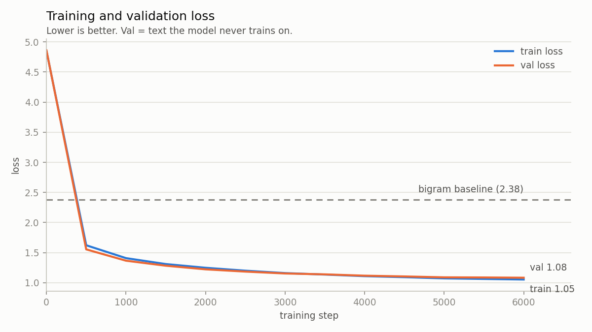

# llm-from-scratch

Building a small **GPT-style language model from scratch in PyTorch**, one piece
at a time, to actually understand how modern LLMs work under the hood — not to
beat them.

It reads a large pile of text, learns the character-level patterns in it, and
generates new text in the same style. A tiny **decoder-only transformer** built
without any pre-made model libraries (tokenizer → embeddings → attention →
training → generation).

The model is intentionally small and not "smart" — the point is learning the
machinery, not shipping a product.

**Stack:** Python · PyTorch · matplotlib (loss curves) · trained locally on
Apple Silicon (MPS).

---

## Progress

- [x] **Stage 1 — Data + tokenizer**
- [x] **Stage 2 — Bigram baseline** (a deliberately dumb model to beat)
- [x] **Stage 3 — The transformer** (self-attention, multi-head, blocks)
- [x] **Stage 4 — Train properly + loss curves** ← *you are here*
- [ ] Stage 5 — Generation (temperature, top-k sampling)
- [ ] Stage 6 — Refactor, one experiment, writeup
- [ ] Stage 7 — Live demo (FastAPI backend)

### Stage 1 — done

A complete character-level data pipeline:

- **Dataset** — ~2.6M characters of public-domain **Sherlock Holmes** text from
  Project Gutenberg. See [data/](data/).
- **Tokenizer** — character-level `encode` / `decode` over a 102-character
  vocabulary. See [tokenizer.py](tokenizer.py).
- **Batching** — train/val split plus random `(input, next-character target)`
  batches, placed on the Mac GPU. See [data.py](data.py).
- **Tests** — round-trip and batch shape/alignment checks. See
  [tests/test_stage1.py](tests/test_stage1.py).

### Stage 2 — done

A **bigram** baseline: the simplest possible model, which predicts the next
character from only the current one. It is a single 102 × 102 lookup table
(10,404 parameters). It is meant to be bad. Its job is to get the whole loop
working (data → model → loss → train → generate) and to set a score for the
transformer to beat. See [bigram.py](bigram.py).

| | Loss |
|---|---|
| Even guess among 102 characters | 4.62 |
| Untrained (random table) | 5.19 |
| Trained, 3,000 steps (~10 s on MPS) | **2.42 train / 2.38 val** |

Sample after training: letter patterns and short words look right, but there is
no meaning yet, because the model only ever sees one character:

```
 thenf ug ly. menok cat   her owie pler  thed beensund he tf  the amullimetheroore  mand mowan on.
```

- **Tests** — output shapes, untrained loss near a blind guess, training lowers
  the loss, generation length. See [tests/test_stage2.py](tests/test_stage2.py).

### Stage 3 — done

A small **decoder-only transformer** (GPT-style), built piece by piece in
[model.py](model.py):

1. Token + position embeddings: *which* character, and *where* it sits
2. One self-attention head, with a mask so no position can see the future
3. Multi-head attention: 4 heads side by side
4. Feed-forward layer, run at every position
5. Transformer block: attention + feed-forward, with residual connections and
   pre-layer-norm
6. 4 blocks stacked, then a final layer norm and a layer that scores the next
   character

834,406 parameters, 128-character context. The training loop in
[train.py](train.py) is shared with the bigram.

| | Val loss |
|---|---|
| Bigram baseline (Stage 2) | 2.38 |
| Transformer, untrained | 4.80 |
| Transformer, trained 5,000 steps (~3 min on MPS) | **1.22** |

Sample after training: real words, punctuation, dialogue and the books' line
indentation, though the sentences don't make sense yet:

```
      “What sholing had drawing it made, and. We open, candle of a platation
      undersonal than must he could have black and her terrible enormations
      from him to her. It cease I could not to assailows that he had
      excited is solding got out of justice. I may peeple.
```

- **Tests** — each piece's shapes, a check that no position can see the future
  (one head and the whole model), generating past the context window, and
  training lowering the loss. See [tests/test_stage3.py](tests/test_stage3.py).

### Stage 4 — done

The same transformer, scaled up and trained the way real models are:

- **Bigger:** 384-number embeddings, 6 heads, 6 blocks, so **10,768,230
  parameters** (about 13× Stage 3). Context (128) and batch size (32) are
  unchanged.
- **Dropout (0.2):** randomly switches off connections while training, so the
  model can't just memorise the text. It's off when measuring and generating.
- **Learning-rate schedule:** 100 warm-up steps up to 1e-3, then a cosine glide
  down to 1e-4 by the last step.
- **Checkpoints:** the model with the best validation loss so far is saved to
  `checkpoints/gpt.pt`, along with its settings and vocabulary, so it can be
  rebuilt without retraining.
- **Loss curves:** train and validation loss are plotted to
  `assets/loss_curve.png`.



| | Val loss |
|---|---|
| Bigram baseline (Stage 2) | 2.38 |
| Small transformer (Stage 3) | 1.22 |
| **Stage 4, trained 6,000 steps** | **1.08** (train 1.05) |

The two curves stay close together, so the model is learning patterns rather
than memorising the training text.

Trained on a rented cloud GPU (an NVIDIA L4 spot machine on Google Cloud) in
**7.4 minutes** (about 17 min on an M5 Mac), for about **$0.07**. The recipe is
[sky.yaml](sky.yaml), run with SkyPilot.

Sample after training: dialogue, speaker tags and paragraphs look like the books,
but the story still doesn't make sense:

```
“It was nothing as a man who was hardly rather in correct,” said Holmes.
“You must prove with his drawing-room, but her husband and made it would
all round.”

“Yes, I will not have the proof to do to be cold that he did.”
```

- **Tests** — dropout on only while training, the warm-up/glide-down schedule,
  saving only on a new best, a checkpoint rebuilding the identical model, and the
  plot being a real PNG. See [tests/test_stage4.py](tests/test_stage4.py).

---

## Quickstart

```bash
# 1. Set up the environment
python3 -m venv .venv
source .venv/bin/activate
pip install -r requirements.txt

# 2. (Optional) rebuild the dataset — a copy is already committed
python scripts/prepare_data.py

# 3. See Stage 1 working: tests + a live demo on the real data
python tests/test_stage1.py

# 4. See Stage 2 working: tests, then train the bigram model and generate text
python tests/test_stage2.py
python bigram.py

# 5. See Stage 3 working: the transformer's pieces
python tests/test_stage3.py

# 6. See Stage 4 working: tests, then train the full model
#    (~17 min on an M5 Mac at full load, or ~7 min on a cloud GPU via sky.yaml)
python tests/test_stage4.py
python train.py
```

Stage 1 prints the tests passing, followed by a demo showing the vocabulary
size, an encode/decode round-trip, and a sample batch mapping each character to
its next-character target. `bigram.py` and `train.py` each print a sample from
the untrained model, the train/val loss as training goes, then a sample after
training. `train.py` also saves the best model to `checkpoints/gpt.pt` and the
loss graph to `assets/loss_curve.png`.

---

## Project structure (so far)

```
llm-from-scratch/
├── config.py            # all settings in one place (context length, batch size, device)
├── tokenizer.py         # character-level encode / decode
├── data.py              # train/val split + random batching
├── bigram.py            # Stage 2 baseline: a one-table model to beat
├── model.py             # Stage 3 transformer: attention, blocks, the GPT class
├── train.py             # training loop (shared by both models), LR schedule,
│                        #   checkpoints, loss plot + trains the GPT
├── scripts/
│   └── prepare_data.py  # downloads & cleans the dataset (reproducible)
├── tests/
│   ├── test_stage1.py   # tokenizer + batching tests, with a live demo
│   ├── test_stage2.py   # bigram model, training and generation tests
│   ├── test_stage3.py   # each transformer piece, no-peeking check, training
│   └── test_stage4.py   # dropout, LR schedule, checkpoint save/load, plot
├── data/
│   ├── input.txt        # the training corpus
│   └── README.md        # dataset source & license
├── notes/               # plain-English learning notes, one per stage
├── assets/
│   └── loss_curve.png   # training graph (made by train.py)
├── checkpoints/         # saved models (made by train.py, not committed)
├── sky.yaml             # recipe for training on a cloud GPU with SkyPilot
├── requirements.txt
└── LICENSE              # MIT
```

More files (`generate.py`, `app.py`, …) arrive in later stages.

---

## License

[MIT](LICENSE) — free to use, learn from, and build on.
Full license details: [hafeezbaig.in/docs/MITLicense](https://www.hafeezbaig.in/docs/MITLicense)

---

Hafeez Baig — [Portfolio](https://hafeezbaig.in)
