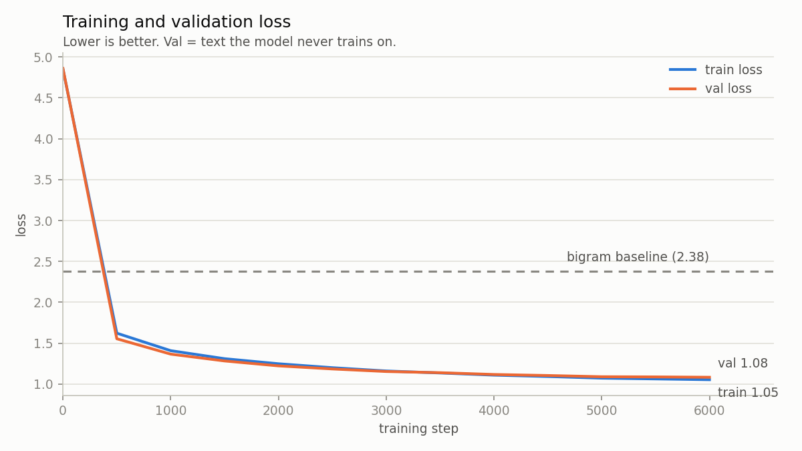

# Stage 4, explained simply

## Where we left off
Robot 2 (Stage 3) worked. It could look back at 128 earlier characters, and it reached a loss of **1.22**, far better than Robot 1's 2.38. But when we stopped it, it was **still improving**. That was a hint: a bigger brain and better studying habits should help.

Stage 4 is about **studying properly**. There's no new big idea like attention. Instead, there are five good habits that every real model uses:

1. a **bigger brain**
2. **dropout** (don't lean on one friend)
3. a **step size that warms up, then slows down**
4. **saving the best version**
5. a **graph** of how studying went

We also changed *where* the robot studied: not on your Mac, but in a rented classroom with a GPU, in Seoul.

## Chapter 1: A bigger brain
Remember the classroom: each student holds a list of numbers, asks questions of earlier students, then thinks alone, in rounds. Stage 4 makes everything bigger:

| | Stage 3 | Stage 4 |
|---|---|---|
| Numbers per student (`N_EMBD`) | 128 | **384** |
| Questions at once (`N_HEAD`) | 4 | **6** (64 numbers each) |
| Rounds (`N_LAYER`) | 4 | **6** |
| Total numbers in the brain | 834,406 | **10,768,230** (about 13× more) |

The row of seats is still **128 characters** long, and each lesson still uses **32 rows** at once. We kept those the same on purpose, so the Stage 1 and Stage 2 numbers stay true and training stays quick.

> In the code: `N_EMBD`, `N_HEAD`, `N_LAYER` in [config.py](../config.py). A comment there keeps the Stage 3 sizes.

## Chapter 2: Don't lean on one friend (dropout)
A bigger brain has a danger: it can **memorise** the books instead of learning how the writing works. A student who memorises does great on the homework, but fails the exam on pages they've never seen.

The trick: in every lesson, **20% of the connections are randomly switched off**, a different random 20% each time. It's as if some classmates randomly cover their ears. No student can rely on one particular friend, so everyone learns patterns that work in many ways.

During the **exam** (measuring the loss) and when **writing**, nobody covers their ears, because dropout is switched off.

> In the code: `DROPOUT = 0.2` in [config.py](../config.py), and `nn.Dropout` in `Head`, `MultiHeadAttention` and `FeedForward` in [model.py](../model.py). `model.eval()` switches it off and `model.train()` switches it back on.

## Chapter 3: Warm up, then slow down (the step size)
In Stage 2 you met the **step size** (learning rate): how big a nudge every number gets after each lesson. Stage 3 used the same step size the whole time. Stage 4 uses a smarter plan, like a runner:

```
step size
 0.001 |    ___
       |   /    ‾‾‾‾‾‾‾‾‾‾‾‾‾---___
       |  /                        ‾‾‾‾---___
       | /                                   ‾‾‾---___
0.0001 |/                                             ‾‾‾  ← end
       +-----------------------------------------------------
        0  100                                        6000   step
        warm-up   big steps while there's lots to learn   careful finish
```

- **Warm up (first 100 steps):** the brain starts as random numbers, so big nudges would throw it around. It starts tiny and grows to 0.001.
- **Glide down (the other 5,900 steps):** big steps early, when there's a lot to learn, then smaller and smaller ones (down to 0.0001), so it settles into a good spot instead of bouncing around it.

> In the code: `get_lr()` in [train.py](../train.py), with `LEARNING_RATE`, `MIN_LR` and `WARMUP_ITERS` in [config.py](../config.py).

## Chapter 4: Keep your best exam paper (checkpoints)
Every 500 steps, the class takes an exam on the **locked drawer** (validation text). If the score is the **best so far**, we take a photo of the whole brain and save it to a file: `checkpoints/gpt.pt`.

The photo holds more than the 10.8 million numbers. It also stores:
- **the settings** (384, 6, 6, …), so we can rebuild a brain of the same shape;
- **the alphabet** (the 102 characters), so the ids turn back into the same letters.

In this run, **every exam was a new best**, so the brain was still improving at the end. The file is **45 MB**.

> In the code: `save_checkpoint()` and the `on_new_best` hook in [train.py](../train.py). The test `test_checkpoint_rebuilds_the_same_model` in [tests/test_stage4.py](../tests/test_stage4.py) checks that the photo rebuilds exactly the same brain.

## Chapter 5: The graph


- **Blue** is the homework score (train) and **orange** is the exam score (val). Lower is better.
- The **dashed line** is Robot 1's best (2.38). Robot 2 passes it before step 500.
- The fast drop is the "big steps" phase; the long slow slide is the careful finish.
- **The two lines stay close together.** That means the robot is learning, not memorising, which is dropout doing its job. Near the end the homework score gets a little better than the exam score (1.05 vs 1.08). That small gap is normal and healthy. A big gap would mean memorising.

> In the code: `plot_losses()` in [train.py](../train.py) draws it and saves it to `assets/loss_curve.png`.

## Chapter 6: The report card, and the writing
```
step     0 | train loss 4.85 | val loss 4.86   ← random brain
step   500 | train loss 1.62 | val loss 1.55   ← already beats Robot 1 (2.38)
step  1000 | train loss 1.41 | val loss 1.37
step  2000 | train loss 1.25 | val loss 1.22   ← where Stage 3 ended
step  3000 | train loss 1.16 | val loss 1.15
step  4000 | train loss 1.11 | val loss 1.12   ← homework now slightly better than exam
step  5000 | train loss 1.07 | val loss 1.09
step  6000 | train loss 1.05 | val loss 1.08   ← final
```

| Robot | Val loss | As good as guessing blindly among… |
|---|---|---|
| Guessing evenly | 4.62 | 102 characters |
| Robot 1 (bigram) | 2.38 | about 11 characters |
| Robot 2, small (Stage 3) | 1.22 | about 3.4 characters |
| **Robot 2, big (Stage 4)** | **1.08** | **about 3.0 characters** |

Real guesses from the saved brain:
```
"Sherlock Holme"   →  s 100%
"my dear Wats"     →  o 100%
"I have no doub"   →  t 100%
"the game is a"    →  space 61%   n 10%   l 9%     ← it doesn't know "the game is afoot"!
```
It's very sure about common phrases, but it hasn't learned the famous "afoot", probably because it appears so rarely in the books.

Before training, it wrote random symbols:
```
p・xvkoz[½・[DæS(2£)PpqEB£B)UègA
```
After training, it writes this:
```
"No; then, in your life," said he. "There is no call fit."

"Why had your park this?"

"It was nothing as a man who was hardly rather in correct," said Holmes.
"You must prove with his drawing-room, but her husband and made it would
all round."

"Yes, I will not have the proof to do to be cold that he did."
```
Compared with Stage 3: the dialogue looks properly formatted, with quotes, "said Holmes" and paragraphs, and the phrases sound much more like the books. It still doesn't *mean* anything. It has learned how Holmes's writing **sounds**, not the story.

## Chapter 7: Studying in a rented classroom
Training this bigger brain on your Mac takes about 17 minutes at full power (we measured 169 ms per step), and the Mac gets hot. So we rented a classroom instead:

- **Where:** a Google Cloud machine in **Seoul**, with an **NVIDIA L4 GPU**, rented as a cheap "spot" machine (Google can take spot machines back at any time).
- **How:** one command (`cloud run`) from your other project, [cloud-compute](../../cloud-compute). It uploaded this project (2.7 MB), installed PyTorch, trained, then we copied the brain and the graph back and deleted the machine.
- **Speed:** training took **7.4 minutes** instead of about 17.
- **Cost:** the machine existed for 14 minutes, including set-up, at $0.28/hour: about **7 cents**.

The recipe for this lives in [sky.yaml](../sky.yaml). How the cloud works is explained in [notes/cloud-gpu.md](cloud-gpu.md) and in the cloud-compute notes.

> Fun fact: the same code ran unchanged on your Mac (`mps`) and on the cloud GPU (`cuda`), because `get_device()` in [config.py](../config.py) picks whatever is available.

## The end of Stage 4
Robot 2 now studies like a real model: a bigger brain, dropout, a smart step size, saved checkpoints and a graph to watch. The loss dropped from **1.22 to 1.08**. Next, in Stage 5, we play with **how it writes**: making it bolder or safer when it picks each next character (temperature and top-k).

## The five words to remember
**Bigger → dropout → warm-up → best photo → graph**

And one rule: *if homework gets much better than the exam, it's memorising.*

## Story → code
| Story | Code |
|---|---|
| Bigger brain | `N_EMBD = 384`, `N_HEAD = 6`, `N_LAYER = 6` in [config.py](../config.py) |
| Classmates randomly covering their ears | `DROPOUT = 0.2`, `nn.Dropout` in [model.py](../model.py) |
| Nobody covers ears in the exam | `model.eval()` (and `model.train()` to switch back) |
| Warm up, then glide down | `get_lr()`, `WARMUP_ITERS`, `LEARNING_RATE`, `MIN_LR` |
| Photo of the best brain | `save_checkpoint()` → `checkpoints/gpt.pt` |
| "Is this the best exam yet?" | the `on_new_best` hook in `train()` |
| The graph | `plot_losses()` → `assets/loss_curve.png` |
| The rented classroom | `sky.yaml` + `cloud run` (cloud-compute) |

## Check yourself
1. What three numbers made the brain bigger, and roughly how many times bigger did it get?
2. Why do some classmates "cover their ears" while studying, and why does nobody do it during the exam?
3. Why start with tiny steps, and why end with small ones?
4. What does the checkpoint file hold besides the brain's numbers, and why?
5. On the graph, what would it mean if the blue line kept going down but the orange line went up?
6. Why did "the game is a" not get an `f`?
7. Why did the same code work on your Mac and on the cloud GPU?

## How to make it stick
1. Read one chapter, look away, and say it out loud in one sentence.
2. The next day, before you read anything, write the five words from memory. Then check.
3. Open [assets/loss_curve.png](../assets/loss_curve.png) and find three things: where Robot 2 passes the dashed line, the fast drop, and where the blue line slips under the orange one.
4. Run `.venv/bin/python tests/test_stage4.py`. Then open [tests/test_stage4.py](../tests/test_stage4.py) and read `test_lr_warms_up_then_glides_down`: its five `assert` lines describe the warm-up and the glide.
5. **Experiment (thinking only, no training):** in [config.py](../config.py), what do you think would happen to the two lines on the graph if `DROPOUT` were `0.0`? Write your guess, then compare it with Chapter 2.
