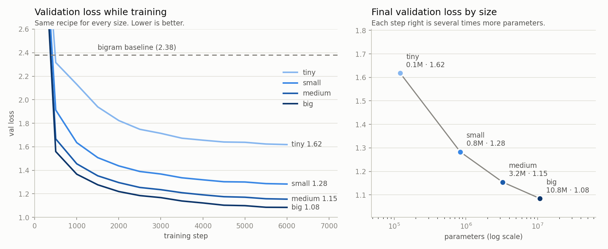

# Stage 6, explained simply

## Where we left off
Robot 2 is trained (Stage 4) and writes on demand, as carefully or as boldly as you like (Stage 5). Stage 6 has three jobs:

1. **one real experiment**, with a graph
2. a **tidy-up** of the code
3. the **write-up**: the README that explains the whole project

The experiment asks one question: **does a bigger brain help, and by how much?**

You might think Stage 4 already answered that: the brain got 13× bigger and the loss dropped from 1.22 to 1.08. But Stage 4 changed **four things at once**: the size, dropout, the step-size plan and the number of steps. So which one did the work? We can't tell. A fair test changes **only one thing**.

## Chapter 1: A fair race
Picture four runners of different sizes on the same track, with the same shoes, the same weather and the same distance. Only the runner changes. Then any difference in their times comes from the runner.

Our four runners:

| Size | Numbers per student | Questions at once | Rounds | Total numbers in the brain |
|---|---|---|---|---|
| tiny | 64 | 4 | 2 | 121,062 |
| small (Stage 3's size) | 128 | 4 | 4 | 834,406 |
| medium | 256 | 4 | 4 | 3,241,574 |
| big (Stage 4's size) | 384 | 6 | 6 | 10,768,230 |

Everything else is the same for all four: the books, the 128-character window, 32 rows per lesson, dropout 0.2, the warm-up-then-glide step size, and 6,000 lessons. Even the **lessons come in the same order**. The dice that pick which pages to study are reset right after each brain is built, so all four study exactly the same pages in exactly the same order.

> In the code: `SIZES` and `run_size()` in [experiments/model_sizes.py](../experiments/model_sizes.py). The two `torch.manual_seed` lines: the first gives every brain repeatable starting numbers, the second gives every brain the same lessons.

## Chapter 2: The classroom that was taken back
Training four brains takes about 17 minutes on a GPU, so we rented a cheap "spot" classroom in **Seoul** ($0.28 an hour). Spot rooms are cheap because the owner can **take them back at any moment**.

That's exactly what happened:
- Tiny, small and medium finished. Big was at lesson 4,000 of 6,000.
- At minute 19, the connection suddenly went silent. Google had taken the machine back and **deleted it, along with its disk**.
- All the results were on that disk, so **everything was lost**. Cost: about 9 cents.

So we made the experiment tougher, the way you'd protect homework:
1. **Save after every subject:** the results file is written after each size finishes.
2. **Skip what's done:** if the file already has a size (trained with the same recipe), a rerun skips it.
3. **Keep a copy at home:** every minute, the results file was copied back to the Mac. A dead classroom can't take it away any more.

The second try found Seoul, Mumbai and Virginia **all sold out**. SkyPilot tried 8 zones by itself and found a spot L4 in **Iowa** ($0.42 an hour) after 5½ minutes. This time all four finished, in 17 minutes of training. Total cost for the stage: about **30 cents**.

> In the code: the "already done, skipping" part of `main()`, and `--fresh` to start over. The cloud-compute notes now include this story too.

## Chapter 3: The results


**Left panel:** each line is one brain's exam score (val loss) while it studied. Darker blue = bigger brain. All four beat Robot 1's dashed line (2.38), and the bigger the brain, the lower its line, at every check from lesson 500 on.

**Right panel:** the final score against the brain's size. The size axis is a **log scale**: each tick is **10× more** than the one before. That's the only way to fit 121 thousand and 10.8 million on one picture.

| Size | Val loss | Better than the size before by | …for how many times more numbers |
|---|---|---|---|
| tiny | 1.62 | | |
| small | 1.28 | 0.34 | 6.9× |
| medium | 1.15 | 0.13 | 3.9× |
| big | 1.08 | 0.07 | 3.3× |

**The big lesson: bigger always helps, but each step helps less.** It's like adding notebooks to a student: the second notebook makes a huge difference, the tenth hardly any. AI researchers call this **diminishing returns**, and it's why giant models need *enormous* sizes to keep improving.

## Chapter 4: Who starts memorising?
Remember the rule from Stage 4: *if the homework score gets much better than the exam score, the robot is memorising.*

| Size | Homework (train) | Exam (val) | Which is better? |
|---|---|---|---|
| tiny | 1.69 | 1.62 | exam |
| small | 1.32 | 1.28 | exam |
| medium | 1.16 | 1.15 | exam (just) |
| big | 1.05 | 1.08 | **homework** |

Why would the exam be *easier* than the homework? The exam pages are the last 10% of the books, and they happen to be a little easier to guess. So look at the **trend**, not one row: the bigger the brain, the more the homework score pulls ahead. Only the big brain has started to memorise, a little. If we trained it much longer, it would need more dropout or more books.

## Chapter 5: A surprise: small did worse than in Stage 3
In Stage 3, the small brain reached **1.22**. Here, the same size reached only **1.28**, even with more lessons and the better step-size plan. Why?

The most likely reason is **dropout**. Stage 3 had none; here 20% of the class covers their ears in every lesson.
- In a **big** class, that's healthy: there are plenty of students, and it stops them copying each other (memorising).
- In a **tiny** class, every student is needed. Covering ears just slows everyone down, and the small brain has nothing to spare.

So the right recipe depends on the size. To be *sure*, you'd run another fair test: small with dropout 0.2 against small with dropout 0, changing only that one thing.

## Chapter 6: What each size writes
Same start, same seed, temperature 0.8:

```
tiny:    “He have stappe of the should the my sand one, and word. It same
small:   He walk. In I have been support of my satisfiend in the states of
medium:  “He was the tap of all fierce. A man who had dead in the states of
         green looking glancing disguise.”
big:     CHAPTER II.
         THE OF OF my DENTOLLE.
```

- **Tiny** barely makes words ("stappe", "the my sand").
- **Small** makes mostly real words, but they don't fit together.
- **Medium** writes dialogue in curly quotes.
- **Big** decided to start a new chapter. It has learned that books have chapter headings, in capitals, on their own lines.

## Chapter 7: Is the difference real, or just luck?
Training uses dice, so two runs could differ by luck. How big is that luck?

- The first try (lost in Seoul) and the second (Iowa) gave **exactly the same** scores for tiny, small and medium, to 4 decimal places: same seed, same kind of GPU, same result.
- The big brain scored **1.0844** here and **1.0832** in Stage 4, where only the order of the lessons was different. So luck moves the score by about **0.001**.
- The gaps between sizes are **0.07 to 0.34**: 70 to 340 times bigger than luck. They're real.

That's what makes it an experiment, not an anecdote.

## Chapter 8: The tidy-up and the write-up
**The tidy-up was small.** The code has been split into small files since Stage 1 (`config`, `tokenizer`, `data`, `model`, `train`, `generate`), so there was nothing messy to untangle. Experiments now get their own folder, `experiments/`, and `sky.yaml` notes how to run this one on a cloud GPU.

**The write-up** is the README. It now has:
- **How it works:** a diagram following "the game is a" from letters, to ids, through the 6 blocks, to 102 scores, to the dice roll;
- every stage's results and graphs;
- **What I learned:** seven lessons from the whole project.

## The end of Stage 6
The robot is built, trained, measured and written up. Last comes Stage 7, **the live demo**: a small web server (`app.py`) that loads the brain once and lets anyone, anywhere, type a start and get text back.

## The five words to remember
**Fair test → save as you go → bigger helps → less each time → check the luck**

And one rule: *change one thing at a time.*

## Story → code
| Story | Code |
|---|---|
| The four runners | `SIZES` in [experiments/model_sizes.py](../experiments/model_sizes.py) |
| Same lessons, same order | `torch.manual_seed(config.SEED + 1)` after building each brain |
| Save after every subject | `json.dump(...)` inside the loop in `main()` |
| Skip what's done | "already done, skipping" in `main()`; `--fresh` to redo |
| The graph | `plot_sizes()` → `assets/model_sizes.png` |
| Every number | [experiments/results/model_sizes.json](../experiments/results/model_sizes.json) |
| Redraw without training | `python experiments/model_sizes.py --plot-only` |
| The rented classroom | `sky.yaml` (its `run:` comment shows the experiment command) |

## Check yourself
1. Why couldn't Stage 4 tell us how much the bigger size helped?
2. What makes this a fair test? Name three things that stayed the same.
3. Why was everything lost when Google took the spot machine back, and what three changes protect the results now?
4. On the right-hand graph, why is the size axis a log scale?
5. Tiny → small helped by 0.34, and medium → big by only 0.07. What's the name for this?
6. Why does the trend in Chapter 4 matter more than any single row?
7. Why did the small brain probably do worse than in Stage 3? How would you test that fairly?
8. How do we know the 0.07 gap between medium and big isn't just luck?

## How to make it stick
1. Read one chapter, look away, and say it out loud in one sentence.
2. The next day, write the five words from memory, then check.
3. Open [assets/model_sizes.png](../assets/model_sizes.png) and find: where each line crosses the dashed bigram line, the line that ends lowest, and the flattening on the right panel.
4. Open [experiments/results/model_sizes.json](../experiments/results/model_sizes.json) and find big's `final_val` and `minutes`. Every number in these notes comes from that file.
5. Run `.venv/bin/python tests/test_stage6.py`, then read `test_rerun_skips_finished_sizes`: it trains tiny, reruns with tiny + small, and checks that only small was trained the second time.
6. **Experiment (thinking only, no training):** if you added a fifth size, 4× bigger than big (about 40 million numbers), what final val loss would you guess? Look at the pattern 0.34 → 0.13 → 0.07 before you answer.
